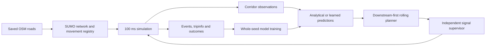

# Running ZELVO

## Local landing page and live comparison

```powershell
powershell -NoProfile -ExecutionPolicy Bypass -File scripts/uv.ps1 sync
powershell -NoProfile -ExecutionPolicy Bypass -File scripts/start-web.ps1
# Open http://127.0.0.1:8000
```

The helper builds the frontend and runs the loopback FastAPI server. Use `-NoBuild` to reuse the build. Development uses `npm.cmd run dev` from `frontend`, with the API running on 8000. All fonts and OSM road geometry render locally.

The live-demo API exposes `GET /api/network`, `POST /api/sessions`, `WS /api/sessions/{id}/stream`, `DELETE /api/sessions/{id}`, and `GET /api/sessions/{id}/receipt`. Each accepted session launches one ordinary actuated and one learned ZELVO libsumo process. At most one pair runs at once. Settings validate density (150/300/600 ordinary vehicles), seed, dispatch (30–180 s) and observation delay (0–6 s). Both policies receive the same saved demand file and configuration.

The physics step remains 0.1 s. Optional read-only telemetry publishes observed vehicle positions, headings, speeds, route signal states and ambulance measurements every 0.2 s, from dispatch to arrival. A final telemetry correction uses authoritative SUMO tripinfo rather than the step-observed arrival timestamp. The renderer buffers observations, interpolates at requestAnimationFrame frequency and holds a common clock to the slower available stream. It never extrapolates missing frames. Playback speed and pause affect only presentation. Independent workers continue to the common 700 s horizon for ordinary-traffic and safety audit results.

Receipts under `results/live/<id>/` retain UTC start/end, settings, input/model/engine hashes, worker exit codes, simulated/wall durations, raw tripinfo, events, predictions and actual frames. A stopped/expired/failed run is explicitly partial. Cancelling writes STOP markers only to that session's worker folders, gives workers a bounded graceful exit and then terminates only owned processes if needed. Disconnected clients have a 60 s grace period; all owned workers are closed on server shutdown. In-memory receipts last until server restart or session eviction; on-disk records remain. These runs never enter the paused evaluation campaign.

The default preset is the independently reproduced 913 m / three-junction demo: **144.2 → 76.6 s, 46.9% saved**, **58.7 → 0 s stopped on red**. Other settings may regress and are displayed as measured. The landing claim is a curated result, not the requested unsupported 48.6% or a population estimate. No physical signals are connected.

Simulation-trained arrival and queue prediction guides a rolling controller, which prepares downstream capacity and asks an independent signal supervisor for priority. See [IMPLEMENTATION.md](IMPLEMENTATION.md) for the specification and [progress.md](progress.md) for verified checkpoints. No paid API, GPU or cloud account is needed.



Traffic states and signal decisions are recalculated from simulation observations. Scenarios fix demand, starting conditions and random seeds for repeatability; they do not prescribe the resulting ambulance trajectory or a sequence of green lights.

## Real road networks

Both networks derive from saved Bengaluru OpenStreetMap data, with left-hand driving, actuated signal plans, three-second yellow and two-second nominal all-red intervals. The hospital district contains 43 controllers and thousands of road/pedestrian edges; the rebuilt stress network contains 282 controllers. Inferred plans and geometry are modelling assumptions, with warnings and targeted refinements retained.

```powershell
# Only needed to download/rebuild the saved source.
node --use-system-ca scripts/fetch-osm.mjs
.\.venv\Scripts\python.exe scripts/merge-osm.py
.\.venv\Scripts\python.exe -m zelvo district --directory scenarios/bengaluru-hospital --source scenarios/bengaluru/district.osm.xml --bbox 77.568 12.957 77.587 12.976
.\.venv\Scripts\python.exe -m zelvo scenario --directory scenarios/bengaluru-hospital --seed 42 --demand 300 --emergencies 2 --horizon 700
```

OSM data © OpenStreetMap contributors, [ODbL 1.0](https://www.openstreetmap.org/copyright). [Source attribution](scenarios/bengaluru/ATTRIBUTION.md) and [hospital attribution](scenarios/bengaluru-hospital/ATTRIBUTION.md) describe assumptions. The destination is road access near Victoria Hospital. Dispatch, clinical outcomes and calibrated pedestrian demand are outside current evidence.

To add repeatable walking traffic while preserving the original comparison:

```powershell
.\.venv\Scripts\python.exe scripts/add-pedestrian-demand.py scenarios/bengaluru-hospital/seed-42-demand-300-ev-2-od-0.json --people 60
.\.venv\Scripts\python.exe -m zelvo run --config scenarios/bengaluru-hospital/seed-42-demand-300-ev-2-od-0-ped-60.json --controller zelvo_analytical --backend libsumo --output results/pedestrian-check
```

This creates separate routes/configuration and labels pedestrian demand synthetic. The seed-42 checkpoint's main matched comparison has no pedestrians; the walking case validates execution and observations separately. All 60 walkers were observed in its completed pilot. Maximum observed continuous pedestrian wait was 3.7 seconds; this is not evidence of a population or field pedestrian benefit.

## Run the engine

```powershell
.\.venv\Scripts\python.exe -m zelvo run --config scenarios/bengaluru-hospital/seed-42-demand-300-ev-2-od-0.json --controller actuated --backend libsumo
.\.venv\Scripts\python.exe -m zelvo run --config scenarios/bengaluru-hospital/seed-42-demand-300-ev-2-od-0.json --controller zelvo_analytical --backend libsumo
.\.venv\Scripts\python.exe -m zelvo run --config scenarios/bengaluru-hospital/seed-42-demand-300-ev-2-od-0.json --controller zelvo_ai --model models/predictor.joblib --backend libsumo
```

Controllers: `fixed_time`, `actuated`, `local_preemption`, `zelvo_analytical`, `zelvo_ai`. The primary normal-ambulance baseline is `actuated`: it makes no priority requests, and shares the corridor occupancy guard used by every variant. It is therefore an actuated baseline with that common guard, rather than unmodified SUMO actuation. AI startup requires a real model and matching hash/version manifest. `traci` remains available for socket-connected simulations; `libsumo` runs the same controller in process. One embedded simulation owns each worker process.

Comparisons use identical saved traffic, seed, route, 100 ms step and recovery horizon. Traffic evolves independently after control changes. The tiny `zelvo smoke` fixture is only a runtime check.

## Control behaviour

- Exact incoming/outgoing lane connections and signal indices identify movements. Slow-vehicle positions estimate extent; halted counts alone do not measure metres of queue.
- The planner looks ahead up to six intersections, estimates arrival windows and queue service time, and walks downstream dependencies before requesting upstream service. Blocked, stale and unsupported predictions are explicit.
- The supervisor preserves legal phase succession, imported pedestrian service and clearance phases. It may shorten eligible green after minimum service or extend compatible green. Receiving space is checked again at execution. Observed corridor internal occupancy can extend all-red.
- Compatible ambulances share service; conflicts use deterministic arbitration. Passage, disappearance, route versions and expiry invalidate individual requests. Priority budgets and recovery periods return time to ordinary traffic.
- Optional `dynamic_routing: true` uses live route costs with a thirty-second improvement threshold. Fixed-route comparisons leave it disabled. `observation_delay_s` exercises stale-data fallback. Lane incidents specify `lane`, `start_s`, `end_s`, and temporary `speed_mps`.

This is an engineering simulation, not certified road-control software. Preserving a program cannot establish that OSM-derived geometry, timings or plans are correct for a real intersection. Ordinary signal cycling may still display green into congestion; ZELVO gates its priority interventions. Full intersection-box occupancy and calibrated contiguous queue length remain limitations.

## Evidence

Every run writes a unique directory containing:

- `result.json`: status, actual tripinfo departure/arrival/journey times, insertion delay, ambulance stopped time/stops, collisions, teleports, versions, input/code/lock hashes, ordinary traffic, pedestrian observations, queue/spillback proxies, safety audit, planner latency and missing metrics/errors.
- `events.jsonl`: approach detection, first movement-permitted green, confirmed crossing, phases, priority decisions, arbitration, fallbacks, incidents, collisions and errors. Response/passage times use common approach zones with 100 ms observation resolution.
- `aggregate.jsonl`: one-second traffic, pending insertion and network congestion observations.
- `predictions.jsonl`: analytical/learned forecasts and arrival windows.
- `training.jsonl`: observed features, future labels, censoring and episode quality flags when enabled.
- Effective `config.json`, raw `tripinfo.xml`, build/process/simulator logs and model references.

Content-addressed copies in `results/inputs` preserve each network/route/model version once. Never-departed vehicles, unfinished ordinary traffic and failed runs remain visible. Completed ambulances do not make an unfinished network run complete. Missing/censored outcomes stay `null`.

| Measurement | Definition |
|---|---|
| Signal response | First movement-permitted green minus entry into the common 150 m approach zone; zero if already green |
| Passage wait | Confirmed stop-line crossing minus approach-zone entry; a green alone does not count as passage |
| Ambulance journey | Tripinfo arrival minus actual departure |
| Scheduled-start response | Arrival minus scheduled departure, including delayed insertion |
| Stopped time and stops | Observed time below 0.1 m/s, with stop events after the vehicle has first moved |
| Ordinary impact | Time loss, waiting, insertion delay, unfinished demand and throughput over the same horizon |

These describe simulated transport and signal response. They do not measure emergency call handling, ambulance dispatch or hospital clinical response.

```powershell
.\.venv\Scripts\python.exe -m zelvo compare results/episodes/BASELINE_RUN/result.json results/episodes/AI_RUN/result.json --output results/comparison.json
```

Comparison rejects changed network/route contents, engine versions, timing, seed or backend. A single pair demonstrates functionality; population improvement requires the later frozen campaign.

## Local AI

```powershell
.\.venv\Scripts\python.exe scripts/collect-training.py --seeds 8 --demand 200 --horizon 700 --backend libsumo --output results/training-v3
.\.venv\Scripts\python.exe -m zelvo train --data results/training-v3 --output models/predictor.joblib
```

Actual scikit-learn `HistGradientBoostingRegressor` models predict ETA residuals/quantiles and receiving-lane queue counts ten seconds ahead. All records sharing a seed stay in one train/validation/test partition across controller variants. Future incidents and labels never enter features. The manifest records data hashes, seed groups, held-out errors, coverage, versions and model hash. Invalid/out-of-support input falls back analytically; predictions never bypass the supervisor.

Training excludes censored target rows, collision/audit-failing episodes and retired batches. Queue fitting currently uses the same fully labelled subset as ETA fitting. Observational policy data do not establish causal action effects. Seed holdouts do not establish unseen-route/city generalization. Closed-loop ambulance and ordinary-traffic outcomes must be measured separately from prediction errors.

Create an output-root `STOP` file to stop a new run/collection gracefully. Development runs are separate from the **20,000 evaluation executions** described below. Retired batches `training-v1` and `training-v2` preserve diagnostics and must not be used to train a model. The trainer rejects inputs beneath a `RETIRED.md` marker.

`python scripts/checkpoint-report.py` rebuilds the checkpoint summary from actual result files, verifies completed ambulance durations against raw tripinfo, and includes the model manifest when present. It does not run simulations or manufacture missing outcomes.

## Integration

```powershell
.\.venv\Scripts\python.exe scripts/check-emulator.py
```

The adapter protocol and fault emulator cover acceptance, activation, passage, duplicates, lost acknowledgements, stale status, cancellation, expiry and restart. An acknowledgement does not prove clear physical service; fresh signal/capacity observations remain required. No traffic hardware is connected. A vendor driver requires authorized access, interface documentation and hardware/sandbox validation.

The intended frontend runs two real simulations side by side with judge controls and buffered interpolation; it is not implemented yet. Current authorization excludes UI work.

## Selected corridor demo

**Current selection:** [46.9% demo evidence](reports/demo-target.md), with input hashes in `scenarios/demo-selection.json`. Two independent matched pairs measured **144.2 → 76.6 s ambulance journeys**, **58.7 → 0 s stopped on red**, and completed all 300 ordinary trips. Acceptance is **45–55% journey savings and <=2 s stopped waiting**; a 30-minute baseline is optional. The selected scenario is a tuned 913.35 m corridor through three signals in the 43-controller district. It is separate from population evaluation.

The following paragraph describes the preserved earlier v1 selection:

See [demo evidence and reproduction](reports/demo-corridor.md). The selected scenario is `scenarios/bengaluru-hospital/demo-long-links-cross-60-depart-20.json`: three real OSM-derived signal junctions, 300 ordinary trips, sustained opposing demand, ambulance departure at second 20. Ordinary actuation versus learned ZELVO measured **28.5 versus 0 seconds stopped on red**, with **153.6 versus 119.5 second journeys**. An independent replay reproduced these measurements. This is a tuned demo, separate from unbiased evaluation.

Current ordinary actuated and fixed-time runs issue no ZELVO occupancy holds; the supervisor audits only. Earlier checkpoint reports used a common occupancy guard and retain their original engine hashes. Do not combine those experiments. Current priority planning includes legal phase-preparation time and separate preparation/service budgets.

`stopped_on_red_s` measures speed below 0.1 m/s, nearest upcoming red signal, within the 150 m approach zone. It differs from signal response and approach-to-crossing time. A moving ambulance can see red before green arrives and still record zero stopped-on-red time.

## Frozen evaluation: 10,000 matched pairs

The primary campaign is **10,000 ordinary actuated executions plus 10,000 learned ZELVO executions**, not 20,000 pairs. Its declared population is 50 seeds (20000–20049), four ordinary-demand levels (300/600/1200/2400), five hospital-bound OD routes per seed, and ten families: ordinary, following emergencies, competing emergencies, corridor queues, downstream incidents, demand bursts, stale telemetry, delayed telemetry, rerouting incidents and pedestrian demand. Both policies receive byte-identical inputs within each pair. The tuned demo and development/training runs are excluded.

Each episode uses the real 43-controller OSM district, 100 ms physics and a 900 s simulated horizon. Traffic is synthetic, resampled from saved validated OD routes; this is not unseen-city evaluation or field-calibrated demand. Seeds are disjoint from model development. Nested demand and related variants are dependent, so uncertainty resamples entire seeds. Evaluation labels measure forecast accuracy but never retrain the frozen model.

```powershell
# Preparation, only for a new empty campaign root:
.\.venv\Scripts\python.exe -m zelvo.campaign freeze --root results/evaluation-v1
# Four actual low/high-load executions establish local resource projections:
.\.venv\Scripts\python.exe -m zelvo.campaign profile --root results/evaluation-v1 --workers 2
# Resume remaining queued jobs; terminal attempts are never repeated automatically:
.\.venv\Scripts\python.exe -m zelvo.campaign run --root results/evaluation-v1 --workers 2
.\.venv\Scripts\python.exe -m zelvo.campaign status --root results/evaluation-v1
.\.venv\Scripts\python.exe -m zelvo.campaign report --root results/evaluation-v1
.\.venv\Scripts\python.exe -m zelvo.campaign audit --root results/evaluation-v1
# Independent headless CLI parity and five-policy pilot, outside the 20k ledger:
.\.venv\Scripts\python.exe scripts/verify-campaign-pilot.py --root results/evaluation-v1
# Long-running coordinator with periodic report/raw-audit refresh:
.\.venv\Scripts\python.exe scripts/run-frozen-campaign.py --root results/evaluation-v1 --workers 2
```

`header.json` freezes the manifest, source copy, dependencies, model and input hashes. Workers import `engine/zelvo` from that campaign, so later workspace changes cannot silently change an ongoing experiment. Absolute input paths currently require keeping the campaign in its original location. Windows workers preload libsumo before SQLite to avoid the verified native DLL import-order conflict.

`ledger.sqlite` records dispatch before launching an isolated process. Each attempt has a UUID, PID, start/end receipt, logs, status, peak memory and measured wall time. `episodes/run-*/result.json` records simulated time, raw SUMO tripinfo, ambulance/ordinary/pedestrian outcomes, signal-response measurements, model activity and safety diagnostics. Raw episode artifacts are losslessly compressed only after SHA-256 verification. Partial and failed attempts remain preserved. The coordinator holds an OS lock; restart reconciles existing workers and receipts before dispatching queued work.

Create `results/evaluation-v1/STOP` to stop **new dispatch** and let active workers finish. Remove only that marker and run the same command to resume. Resource limits pause dispatch below 768 MiB free memory or 5 GiB free disk. Two workers are the default; throughput and storage must be measured on this computer. A queued job is not evidence of an executed simulation. `profile.json` projects runtime from actual runs and is not a completion guarantee.

The primary calculation gives each matched scenario equal weight, averaging its ambulance journeys first when there are two emergencies:

`mean_saved_seconds = mean_without_seconds - mean_with_seconds`

`percent_reduction_in_mean = 100 * mean_saved_seconds / mean_without_seconds`

The mean of individual percentage savings is also reported separately. Missing, censored, regressed and unsafe pairs are counted explicitly. Unsafe complete pairs remain in the measured mean and are flagged. A conditional estimate from completed pairs must be read alongside completion rates and its denominator. The 45–55% acceptance target is checked against results; it is never substituted for them or enforced by filtering outcomes. The current 46.9% curated demo does not establish that mean for the broader campaign.

`report.json` and `report.md` contain counts, paired means, seed-cluster uncertainty, family/load breakdowns and ordinary-traffic tradeoffs. `execution-evidence.jsonl` lists every recorded attempt with UTC start/end, wall/simulated time and hashes. `timing-audit-20.json` provides up to twenty actual terminal execution receipts, explicitly stating how many exist. `raw-evidence-audit.json` checks archived bytes and reconciles completed ambulance durations against authoritative SUMO XML, sampling twenty attempts plus the five worst paired scenarios. These files establish what actually ran on this machine; they are not independent third-party certification.

The long-running helper refreshes reports after twenty terminal executions, then every ten minutes when progress exists. It runs an audit with each such refresh. `--wait-profile --verify-pilot` waits for an already-running profile and executes the separate CLI parity/ablation pilot before starting remaining jobs. A failed parity check halts that continuation with logs rather than dispatching an unvalidated large batch. `monitor-started.json`, `background.json` and `background-ended.json` identify the monitor/coordinator lifecycle; `monitor.stdout.log`, `monitor.stderr.log` and coordinator logs preserve diagnostics. The helper does not prevent Windows sleep or shutdown; resume after restart using the same root.

## Backend delivery checkpoint

UI and large evaluation are explicitly deferred. `results/evaluation-v1/STOP` remains in place and its automatic continuation monitor is stopped. Four original attempts remain recorded: two full-horizon episodes with completed ambulance journeys but incomplete ordinary-network clearance, and two high-load timeouts. The broad campaign target is unproven. The proposed fast event-based simulator is a plan, not implemented evidence.

Windows verification exposed two storage defects: transient denial when replacing a status file, and concurrent publication of a shared network copy. Atomic JSON writes now retry permission errors within a bounded window; shared input publication uses a per-content OS lock and bounded permission retries. Persistent errors still surface and preserve existing documents. The interrupted and failed attempts remain in their original roots. Corrected engine SHA-256: `81c93e10039f746c333b4efbd561924bb4bdf5e6ba51a663652aa642b77879f1`.

The small `results/backend-checkpoint-v3` is **one district scenario / two policy jobs**, explicitly outside the large evaluation count. It verifies corrected worker execution and direct-CLI parity. Its separate five-policy replay reports ordinary actuation, fixed-time, local preemption, analytical ZELVO and learned ZELVO. All original comparisons and versions are retained; backend version changes are never pooled into one benchmark.

`results/backend-delivery-v3/verification.json` records a fresh full SUMO replay of the selected corridor on that corrected engine: **144.2 → 76.6 s (46.8793%)**, **58.7 → 0 s stopped on red**, both policies clearing 300 ordinary vehicles, zero recorded collisions/teleports/phase-audit errors, and raw ambulance tripinfo reconciliation. Ordinary traffic impacts are included. This is a tuned demonstration, not a population or isolated causal ML-benefit result.

Reproduction helpers:

```powershell
# For a new small checkpoint only; never overwrites an existing root:
.\.venv\Scripts\python.exe scripts/prepare-backend-checkpoint.py --output results/backend-checkpoint-v3
.\.venv\Scripts\python.exe -m zelvo.campaign run --root results/backend-checkpoint-v3 --workers 2
.\.venv\Scripts\python.exe scripts/verify-campaign-pilot.py --root results/backend-checkpoint-v3
.\.venv\Scripts\python.exe scripts/verify-backend-demo.py --root results/backend-checkpoint-v3 --output results/backend-delivery-v3 --workers 1
.\.venv\Scripts\python.exe scripts/package-backend.py --campaign results/backend-checkpoint-v3 --delivery results/backend-delivery-v3 --output dist/zelvo-backend.zip
```

The backend archive whitelists source, frozen model/dependencies, selected road/demand, attribution, measurements and raw evidence. It contains a relative-path demo configuration, setup/run commands, an original-path map and a SHA-256 member manifest; the ZIP receives a separate checksum. Optional netconvert logs are explicitly unavailable for episodes using a precompiled network. Secrets, environments and unrelated files are excluded by the whitelist. A verified backend bundle does not include a frontend, physical-controller driver, complete stress-map validation or a completed large benchmark.


## Larger curated live preset

`scenarios/bengaluru-curated-demo/expanded.json` is a contiguous 2,442.08 m OSM route with 10 unique signal controllers, within a 45-controller local network. Its endpoint is a simulated hospital destination, not Victoria Hospital or a surveyed medical facility. The original ambulance driving parameters, safety supervisor, clearance intervals and pedestrian service remain in force. Both worlds receive identical road, demand, seed and vehicle inputs.

This is an openly curated synthetic peak condition. Opposing vehicle-only service phases receive a common 90-second nominal/maximum service allowance while retaining imported minimum green and clearance. Demand comprises 560 vehicles on seven protected crossing routes, using the saved geometric schedule. Selection used development trial b026b290689e467799d1ea2b678a9ac7 and its dense contiguous prefix; it is not held-out evaluation. Failed larger-route attempts are retained in `reports/curated-development-index.json`.

The first full pair measured 474.7 / 245.5 s (48.2831% saved), 207.9 / 0 s stopped on red, all 560 ordinary trips completed per world, and zero recorded collisions, teleports or signal-audit errors. Ordinary observed time loss plus insertion delay increased by 1,467.63 vehicle-seconds, about 2.62 seconds per scheduled vehicle, on this pair. These are simulation observations, not field certification or a population estimate.

The observer now accounts for unshortenable pedestrian-serving phases when estimating preparation time. It uses their possible actuated maximum instead of assuming an 8-second cut the supervisor cannot perform. Pedestrian service and the independent safety boundary are unchanged.

Reproduce a development pair with `.venv\Scripts\python.exe scripts/validate-demo-candidate.py scenarios/bengaluru-curated-demo/expanded.json`. Run the full browser replay using `npm.cmd run test:e2e -- curated.spec.ts` from `frontend` against the local server. `scripts/verify-curated-demo.py` reconciles both accepted pairs to raw SUMO tripinfo and checks timestamps, input/engine hashes, target range, ordinary completion and safety observations. Proof is saved to `reports/curated-demo-verification.json`. The large 20,000-execution campaign remains paused.
